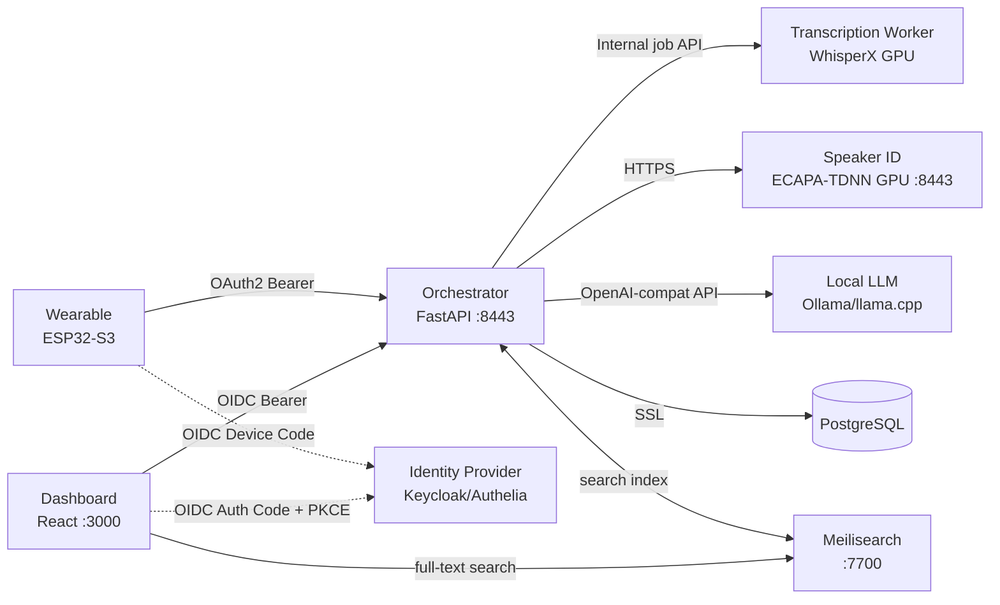

# LifeLog

> **Early Stage / Vibe Coded**
> This project has been heavily AI-assisted ("vibe coded") and is in very early stages of development. It has not been tested on real hardware, the API may change without notice, and there are likely bugs. Use at your own risk — but contributions and issues are welcome.

A **self-hosted, privacy-first** voice journal. Your recordings, transcriptions, and summaries never leave your own hardware. No cloud services, no third-party APIs, no telemetry — everything runs on machines you control.

Wear a small recorder, forget about it, and review your days through a web dashboard — complete with transcriptions, speaker identification, summaries, TODOs, and decisions extracted automatically. Your life data stays inside your own walls.

## Features

**Privacy & Security**
- **Fully self-hosted** — No data leaves your network. No cloud APIs, no external services required
- **Per-user encryption** — Audio files encrypted at rest with Fernet keys derived from user-specific secrets
- **HTTPS everywhere** — All inter-service communication encrypted with mutual TLS
- **Database isolation** — Only the orchestrator touches PostgreSQL; GPU services never see your data
- **OIDC authentication** — Dashboard login via your own identity provider (Keycloak, Auth0, Authelia)
- **Local LLM only** — Summarization runs on your own GPU via Ollama, llama.cpp, or any OpenAI-compatible endpoint

**Recording & Processing**
- **Chunked upload** — Device streams audio in chunks; server tracks utterances and processes on completion
- **Background pipeline** — Worker polls for pending utterances and runs transcription, speaker identification, and summarization asynchronously
- **Session grouping** — Utterances grouped into sessions; quick ASR keeps active transcripts responsive and hourly reprocessing queues ten-minute full jobs
- **Asynchronous transcription + diarization** — A standalone GPU transcription-worker runs WhisperX; the server finalizes results and persists encrypted speaker audio
- **Speaker identification** — ECAPA-TDNN voiceprint matching with one-shot enrollment
- **LLM summarization** — Extracts summaries, TODOs, decisions, calendar events, and notes from conversations

**Dashboard & Review**
- **Interactive calendar** — Browse recordings by day, week, month; date persists in URL for back/forward navigation
- **Audio playback** — Play recordings with color-coded speaker segments, click to seek
- **Category filtering** — Filter recordings by work, personal, or other
- **Daily summaries** — LLM-generated Work/Personal breakdowns per day
- **Speaker labeling** — Label unknown speakers once, retroactively re-identifies across all past recordings
- **TODO & decision tracking** — Automatically extracted from conversations
- **Multi-service architecture** — Orchestrator + GPU services, scalable and distributable

## Privacy & Security

LifeLog is designed so that **your voice data never touches the outside internet**:

| Layer | Protection |
|-------|------------|
| **At rest** | Audio files encrypted with per-user Fernet keys (PBKDF2-derived). Even if someone accesses the disk, they cannot read your recordings |
| **In transit** | HTTPS with mutual TLS between all services. No plaintext on the wire |
| **Database** | PostgreSQL with SSL connections. Only the orchestrator has direct DB access — GPU services have no DB credentials and receive audio/transcripts via HTTP request bodies, not DB queries. **Note**: PostgreSQL data files are not encrypted at rest. For full protection, enable whole-disk encryption (LUKS, BitLocker, FileVault, or cloud-provider encryption) on the host machine |
| **LLM** | Runs locally on your hardware via Ollama/llama.cpp. No audio or transcripts are sent to OpenAI, Anthropic, or any cloud provider |
| **STT & Diarization** | WhisperX runs on your own GPU machines. No audio leaves your network |
| **Dashboard** | OIDC authentication against your own identity provider. No third-party analytics or tracking |
| **Device auth** | OAuth2 device code flow (RFC 8628). ESP32 obtains JWT access tokens from your OIDC provider via device authorization. Tokens stored in ESP32 flash (Preferences/NVS), not SD card. Dashboard uses OIDC authorization code with PKCE. No API keys stored in firmware or database |

The only external network call the system makes is to your own LLM endpoint — which you control.
> **Encryption at rest**: Application-level encryption (Fernet) protects audio files on disk. PostgreSQL data files are stored unencrypted. For complete data-at-rest protection, enable whole-disk encryption on the server hosting this stack. LUKS (Linux), BitLocker (Windows), or FileVault (macOS) are recommended. Cloud providers offer volume-level encryption (AWS EBS encryption, GCP Persistent Disk encryption, Azure Disk Encryption) that requires no application changes.

## Architecture

See **[ARCHITECTURE.md](ARCHITECTURE.md)** for full architecture diagrams, endpoint documentation, database schema, security model, and data flow details.

High-level:



GPU services (transcription-worker, speaker-id) run on dedicated machines. The orchestrator, database, dashboard, and Meilisearch run in Docker on the main server. **Nothing runs in the cloud.**

## Quick Start with Published Images

The fastest way to get LifeLog running. Images are published to GitHub Container Registry on every merge to `main`.

### Prerequisites

- **Docker** with Docker Compose v2+ and **NVIDIA GPU** (transcription-worker + speaker-id)
- A machine running an **OpenAI-compatible LLM** (Ollama, llama.cpp, vLLM)
- An **OIDC provider** (Keycloak, Auth0, Authelia, etc.)

### 1. (Optional) Pre-pull images

```bash
docker pull ghcr.io/dlgreenwald/lifelog-server:latest
docker pull ghcr.io/dlgreenwald/lifelog-transcription-worker:latest
docker pull ghcr.io/dlgreenwald/lifelog-speaker-id:latest
docker pull ghcr.io/dlgreenwald/lifelog-dashboard:latest
```

`docker-compose up -d` pulls automatically if the image is not present locally. Pre-pulling is only useful to verify connectivity to GHCR or to warm the cache before deploying.

### 2. Create your docker-compose.yml

Save the following as `docker-compose.yml` in a new directory. Copy the `.env` variables from the table below into a `.env` file in the same directory, then start the stack.

```yaml
# docker-compose.yml — uses published GHCR images
# All user-specific values are read from environment variables.
# Define them in a .env file or export them in your shell before running.
version: "3.8"

x-common-env: &common-env
  POSTGRES_PASSWORD: ${POSTGRES_PASSWORD}
  OPENAI_BASE_URL: ${OPENAI_BASE_URL}
  OPENAI_MODEL: ${OPENAI_MODEL}
  HF_TOKEN: ${HF_TOKEN}
  OIDC_ISSUER_URL: ${OIDC_ISSUER_URL}
  OIDC_CLIENT_ID: ${OIDC_CLIENT_ID:-lifelog-dashboard}

services:
  postgres:
    image: postgres:16-alpine
    environment:
      POSTGRES_DB: lifelog
      POSTGRES_USER: lifelog
      POSTGRES_PASSWORD: ${POSTGRES_PASSWORD}
    volumes:
      - postgres-data:/var/lib/postgresql/data
    healthcheck:
      test: ["CMD-SHELL", "pg_isready -U lifelog"]
      interval: 10s
      timeout: 5s
      retries: 5

  meilisearch:
    image: getmeili/meilisearch:v1.12
    ports:
      - "7700:7700"
    volumes:
      - meilisearch-data:/meili_data
    environment:
      MEILI_MASTER_KEY: ${MEILI_MASTER_KEY:-searchdevkey}
      MEILI_ENV: development
    healthcheck:
      test: ["CMD", "wget", "--no-verbose", "--spider", "http://127.0.0.1:7700/health"]
      interval: 10s
      timeout: 5s
      retries: 5

  server:
    image: ghcr.io/dlgreenwald/lifelog-server:latest
    ports:
      - "8444:8443"
    environment:
      <<: *common-env
      SPEAKER_ID_URL: "http://speaker-id:8443"
      MEILI_HOST: "http://meilisearch:7700"
      MEILI_MASTER_KEY: ${MEILI_MASTER_KEY:-searchdevkey}
      POSTGRES_HOST: postgres
      POSTGRES_PORT: 5432
      POSTGRES_DB: lifelog
      POSTGRES_USER: lifelog
      CORS_ORIGINS: ${CORS_ORIGINS:-http://localhost:3000}
    extra_hosts:
      - "host.docker.internal:host-gateway"
    volumes:
      - audio-data:/data/audio
    depends_on:
      postgres:
        condition: service_healthy
      meilisearch:
        condition: service_healthy
    healthcheck:
      test: ["CMD", "python3", "-c", "import urllib.request; urllib.request.urlopen('http://127.0.0.1:8443/health')"]
      interval: 10s
      timeout: 5s
      retries: 5
      start_period: 30s

  transcription-worker:
    image: ghcr.io/dlgreenwald/lifelog-transcription-worker:latest
    ports:
      - "9001:9000"
    environment:
      SERVER_URL: "http://server:8443"
      HF_TOKEN: ${HF_TOKEN}
      ASR_MODEL: large-v3
      ASR_DEVICE: cuda
      ASR_COMPUTE_TYPE: int8
      IDLE_UNLOAD_SECONDS: ${TRANSCRIPTION_IDLE_UNLOAD_SECONDS:-300}
      WARM_KEEPALIVE_SECONDS: ${TRANSCRIPTION_WARM_KEEPALIVE_SECONDS:-60}
      IDLE_PROCESS_RESTART_SECONDS: ${TRANSCRIPTION_IDLE_PROCESS_RESTART_SECONDS:-900}
      PYTORCH_CUDA_ALLOC_CONF: expandable_segments:True
    volumes:
      - hf-cache:/root/.cache/huggingface
    depends_on:
      server:
        condition: service_healthy
    deploy:
      resources:
        reservations:
          devices:
            - driver: nvidia
              count: 1
              capabilities: [gpu]
    restart: unless-stopped

  speaker-id:
    image: ghcr.io/dlgreenwald/lifelog-speaker-id:latest
    ports:
      - "8445:8443"
    environment:
      HF_TOKEN: ${HF_TOKEN}
      PYTORCH_CUDA_ALLOC_CONF: expandable_segments:True
    deploy:
      resources:
        reservations:
          devices:
            - driver: nvidia
              count: 1
              capabilities: [gpu]
    restart: unless-stopped

  dashboard:
    image: ghcr.io/dlgreenwald/lifelog-dashboard:latest
    ports:
      - "3000:80"
    environment:
      OIDC_ISSUER_URL: ${OIDC_ISSUER_URL}
      OIDC_CLIENT_ID: ${OIDC_CLIENT_ID:-lifelog-dashboard}
    depends_on:
      - server
    restart: unless-stopped

volumes:
  postgres-data:
  audio-data:
  meilisearch-data:
  hf-cache:
```

Create a `.env` file next to `docker-compose.yml` with at least these variables:

```bash
# .env — required variables (no defaults; must be set)
POSTGRES_PASSWORD=change-me-to-a-strong-password
OPENAI_BASE_URL=http://host.docker.internal:11434/v1
OPENAI_MODEL=qwen2.5:7b
HF_TOKEN=hf_your-huggingface-token-here
OIDC_ISSUER_URL=https://keycloak.example.com/realms/lifelog
OIDC_CLIENT_ID=lifelog-dashboard

# Optional — defaults shown
MEILI_MASTER_KEY=searchdevkey
CORS_ORIGINS=http://localhost:3000
TRANSCRIPTION_IDLE_UNLOAD_SECONDS=300
TRANSCRIPTION_WARM_KEEPALIVE_SECONDS=60
TRANSCRIPTION_IDLE_PROCESS_RESTART_SECONDS=900
```

> **LLM server**: `host.docker.internal` reaches the Docker host machine. Change `OPENAI_BASE_URL` to match your LLM backend:
> - **Ollama**: `http://host.docker.internal:11434/v1`
> - **llama.cpp**: `http://host.docker.internal:8080/v1`
> - **vLLM**: `http://host.docker.internal:8000/v1`
> - **LM Studio**: `http://host.docker.internal:1234/v1`

### 3. Start the stack

```bash
docker-compose up -d
```

Services started:

| Service | URL | Notes |
|---------|-----|-------|
| **Dashboard** | `http://localhost:3000` | React SPA |
| **Orchestrator** | `https://localhost:8444` | FastAPI, HTTPS |
| **Transcription worker** | `http://localhost:9001/health` | WhisperX transcription + diarization, GPU |
| **Speaker ID** | `https://localhost:8445` | ECAPA-TDNN, GPU |
| **PostgreSQL** | `localhost:5432` | SSL enabled |
| **Meilisearch** | `localhost:7700` | Full-text search index |

Check service health:

```bash
docker-compose ps
docker-compose logs -f server    # tail orchestrator logs
```

### 4. Open the dashboard

Navigate to `http://localhost:3000` and log in via your OIDC provider.

### 5. Flash the firmware

Pre-built firmware images (including esp-sr models for noise suppression and VAD) are published to GitHub Actions after every merge to `main`.

**Download the firmware**

1. Go to the repository's **Actions** tab → **Workflows** → **main-firmware** → the latest green run.
2. Download the **`firmware-main-<sha>`** artifact.
3. Extract the archive — you need `bootloader.bin`, `partitions.bin`, `firmware.bin`, and `srmodels.bin`.

Or, if a [release](https://github.com/dlgreenwald/lifelog/releases) exists, download the firmware assets from there.

**Flash using a browser**

No software installation required — use the official **Espressif ESP Tool** in your browser:

1. Open **[https://espressif.github.io/esptool-js/](https://espressif.github.io/esptool-js/)** in Chrome or Edge.
2. Click **Connect** and select your XIAO ESP32-S3 serial port.
3. Add the four bin files with their addresses:
   | File | Address |
   |------|---------|
   | `bootloader.bin` | `0x0` |
   | `partitions.bin` | `0x8000` |
   | `firmware.bin` | `0x10000` |
   | `srmodels.bin` | `0x610000` |
4. Click **Program** to flash them all.

The esp-sr models (noise suppression + voice activity detection) are MIT-licensed and bundled in `srmodels.bin` from the same build — no separate download required.

### 6. Configure WiFi and OIDC on the device

On first boot, the ESP32 creates a WiFi access point. Connect to it and navigate to `192.168.4.1` to enter your OIDC provider credentials and device code. The device uses RFC 8628 device code flow to obtain access tokens, which are stored in internal flash — no API keys need to be programmed into the firmware.

---

## Building from Source (Development)

If you want to run the latest unreleased code or contribute changes, clone and build locally:

```bash
git clone <repo-url> lifelog
cd lifelog

# Create your environment file
cp .env.example .env
# Edit .env with your values

# Generate self-signed TLS certificates for inter-service HTTPS
./scripts/generate-certs.sh

# Build and start all services
docker-compose up -d
```

> **Note**: Building from source requires Docker buildx and may take 10–20 minutes on first build due to WhisperX and ECAPA-TDNN model downloads.

### Prerequisites (building from source)

- **Docker** with Docker Compose v2+
- **NVIDIA GPU** (for transcription-worker and speaker-id services)
- A machine running an **OpenAI-compatible LLM** (Ollama, llama.cpp, vLLM)
- An **OIDC provider** (Keycloak, Auth0, Authelia, etc.)
- **Node.js 20+** (only for dashboard dev without Docker)
- **PlatformIO** (only for firmware)

## Configuration Reference

All configuration is via environment variables. Copy `.env.example` to `.env` and set at least the required variables before starting.

### Required

| Variable | Description |
|----------|-------------|
| `POSTGRES_PASSWORD` | PostgreSQL password for the `lifelog` database user |
| `OPENAI_BASE_URL` | Your LLM server — `http://host.docker.internal:11434/v1` for Ollama on the host, `http://host.docker.internal:8080/v1` for llama.cpp, `http://host.docker.internal:8000/v1` for vLLM |
| `OPENAI_MODEL` | Model name running on your LLM server (e.g. `qwen2.5:7b`, `llama3.3:70b`) |
| `HF_TOKEN` | Hugging Face token with accepted model terms for the pyannote diarization model used by the transcription worker |
| `OIDC_ISSUER_URL` | Your OIDC provider's issuer URL (e.g. `https://your-keycloak.example.com/realms/lifelog`) |
| `OIDC_CLIENT_ID` | OIDC client ID registered for the dashboard |

### Optional

| Variable | Default | Description |
|----------|---------|-------------|
| `OPENAI_API_KEY` | `ollama` | API key for your LLM endpoint (Ollama ignores this) |
| `SPEAKER_ID_URL` | `http://speaker-id:8443` | Internal URL of the speaker-id service |
| `TRANSCRIPTION_SERVER_URL` | `http://server:8443` | Internal URL the transcription worker uses to poll jobs |
| `TRANSCRIPTION_WORKER_POLL_INTERVAL` | `5` | Seconds between job polls by the transcription worker |
| `TRANSCRIPTION_IDLE_UNLOAD_SECONDS` | `300` | Unload WhisperX models after this many seconds of inactivity |
| `TRANSCRIPTION_WARM_KEEPALIVE_SECONDS` | `60` | Keep models warm for this long after a job completes |
| `TRANSCRIPTION_IDLE_PROCESS_RESTART_SECONDS` | `900` | Exit and restart the container after extended idleness (reclaims GPU memory from CTranslate2/pyannote pinned buffers that in-process unload cannot free) |
| `INSTANT_ASR_MODEL` | `large-v3` | WhisperX model for quick (ASR-only) transcripts |
| `INSTANT_ASR_LANGUAGE` | _(auto)_ | Language code for instant transcripts; leave empty for auto-detection |
| `MEILI_HOST` | `http://meilisearch:7700` | Internal Meilisearch URL |
| `MEILI_MASTER_KEY` | `searchdevkey` | Meilisearch master key |
| `CORS_ORIGINS` | `http://localhost:3000` | Comma-separated list of allowed CORS origins |
| `LOG_LEVEL` | `INFO` | Python log level (`DEBUG`, `INFO`, `WARNING`) |
| `OIDC_SIMULATOR_CLIENT_ID` | _(none)_ | Enable OIDC token simulator for development without a real IdP |

### OIDC Provider Setup

Register a new client in your identity provider with the following settings:

- **Client ID**: `lifelog-dashboard` (or your chosen `OIDC_CLIENT_ID`)
- **Client type**: Public (SPA)
- **Redirect URI**: `http://localhost:3000` (or your dashboard URL)
- **Token endpoint auth method**: `None` or `PKCE`
- **Scopes**: `openid`, `profile`, `email`

For Keycloak, also ensure `Direct Access Grants` is disabled and `Standard Flow` (authorization code) is enabled.

### Pinning a Specific Version

The `:latest` tag always tracks the `main` branch. To pin to a stable release:

```bash
# List available tags at ghcr.io/dlgreenwald/lifelog-server
docker pull ghcr.io/dlgreenwald/lifelog-server:v0.1.0
docker pull ghcr.io/dlgreenwald/lifelog-transcription-worker:v0.1.0
docker pull ghcr.io/dlgreenwald/lifelog-speaker-id:v0.1.0
docker pull ghcr.io/dlgreenwald/lifelog-dashboard:v0.1.0
```

Then update the `image:` values in your `docker-compose.images.yml`.

---

## Firmware

See **[firmware-ota/](firmware-ota/)** for the ESP32-S3 firmware source code and **[firmware-ota/ARCHITECTURE.md](firmware-ota/ARCHITECTURE.md)** for a deep-dive into the FreeRTOS task model, audio pipeline, and shared state.

### Hardware

| Component | Part | Notes |
|-----------|------|-------|
| Board | [XIAO ESP32-S3 Sense](https://www.seeedstudio.com/XIAO-ESP32S3-Microcontroller-v2-0-p-5853.html) | 8MB PSRAM, built-in PDM mic + SD slot |
| Microphone | Built-in PDM mic | GPIO 42 (CLK), GPIO 41 (DIN) |
| SD Card | SPI mode | CS=GPIO 21, MOSI=GPIO 38, MISO=GPIO 39, SCLK=GPIO 40 |
| Battery | 400mAh LiPo | ~11 hours with VAD |

### Build and flash

```bash
cd firmware-ota

# Build
pio run

# Flash via OTA (requires WiFi, and device already configured)
pio run -t upload

# Flash via USB (first flash, or when OTA unavailable)
# Full clean flash — bootloader + partitions + firmware + models:
esptool.py --chip esp32s3 --port /dev/ttyACM1 erase_flash
esptool.py --chip esp32s3 --port /dev/ttyACM1 --baud 921600 \
  write_flash \
    0x0 .pio/build/xiao_esp32s3/bootloader.bin \
    0x8000 .pio/build/xiao_esp32s3/partitions.bin \
    0x10000 .pio/build/xiao_esp32s3/firmware.bin

# Pack and flash esp-sr models (see firmware-ota/README.md#model-partition)
python3 -c "
import struct, os
MODEL_DIR = '.pio/libdeps/xiao_esp32s3/esp-sr/model'
STR_LEN = 32
def pack_string(s):
    b = s.encode('utf-8')[:STR_LEN]
    return b + b'\x00' * (STR_LEN - len(b))
needed = {
    'nsnet2': os.path.join(MODEL_DIR, 'nsnet_model/nsnet2'),
    'mn4q8_cn': os.path.join(MODEL_DIR, 'multinet_model/mn4q8_cn'),
}
models = {}
for name, path in needed.items():
    files = {}
    for f in sorted(os.listdir(path)):
        fp = os.path.join(path, f)
        if os.path.isfile(fp):
            with open(fp, 'rb') as fh:
                files[f] = fh.read()
    if files: models[name] = files
file_count = sum(len(v) for v in models.values())
header_size = 4 + len(models) * (STR_LEN + 4) + file_count * (STR_LEN + 4 + 4)
data_offsets = {}
current_offset = header_size
for name in sorted(models.keys()):
    for fname in sorted(models[name].keys()):
        data_offsets[(name, fname)] = current_offset
        current_offset += len(models[name][fname])
out = struct.pack('I', len(models))
for name in sorted(models.keys()):
    out += pack_string(name)
    out += struct.pack('I', len(models[name]))
    for fname in sorted(models[name].keys()):
        out += pack_string(fname)
        out += struct.pack('I', data_offsets[(name, fname)])
        out += struct.pack('I', len(models[name][fname]))
for name in sorted(models.keys()):
    for fname in sorted(models[name].keys()):
        out += models[name][fname]
with open(os.path.join(MODEL_DIR, 'srmodels.bin'), 'wb') as f:
    f.write(out)
print(f'Packed {len(out)/1024:.0f} KB ({len(out)} bytes)')
"
esptool.py --chip esp32s3 --port /dev/ttyACM1 --baud 921600 \
  write_flash 0x610000 .pio/libdeps/xiao_esp32s3/esp-sr/model/srmodels.bin

# Reset device — WiFi config portal appears on first boot
# Monitor serial output
pio device monitor
```

For firmware-only updates (models already on device), see [firmware-ota/README.md](firmware-ota/README.md).

### What the firmware does

1. Connects to WiFi (auto-reconnect with exponential backoff)
2. Reads audio from built-in PDM mic at 16kHz/16-bit
3. Processes through esp-sr AFE (noise suppression + voice activity detection)
4. Encodes to Opus/OGG at ~24kbps
5. Stores on SD card (offline queue)
6. Uploads chunks via HTTPS to the server with OAuth2 Bearer token
7. Server processes utterances in background (transcription → speaker ID → summarization)

## Development

### Server (Python)

```bash
cd server
uv venv .venv
uv pip install -e ".[dev]"
.venv/bin/python -m pytest tests/ -v
```

### Dashboard (React)

```bash
cd dashboard
npm install
npm run dev      # http://localhost:5173 (proxies /api to server)
npm test          # Run vitest
```

### Running tests

```bash
# Python services
cd server && .venv/bin/python -m pytest tests/ -q        # 180 tests
cd diarization && .venv/bin/python -m pytest tests/ -q   # 8 tests
cd speaker-id && .venv/bin/python -m pytest tests/ -q    # 19 tests
cd transcription-worker && python -m pytest -q           # 35 tests

# Dashboard
cd dashboard && npx vitest run                            # 119 tests

# Firmware (native tests, no hardware required)
cd firmware-ota && pio test -e test                       # 78 tests
**Total: ~439 tests** across 6 components.


## Project Structure

```
lifelog/
├── firmware-ota/       ESP32-S3 FreeRTOS firmware (C++/Arduino)
├── server/             FastAPI orchestrator (Python)
├── transcription-worker/ Standalone WhisperX ASR + diarization worker (GPU)
├── speaker-id/         ECAPA-TDNN microservice (Python)
├── dashboard/          React SPA (TypeScript)
├── diarization/        Legacy pyannote.audio microservice (Python)
├── device-sim/        Device simulator for integration testing
├── scripts/            TLS cert generation
├── docker-compose.yml  Service orchestration
├── ARCHITECTURE.md     Full architecture documentation
├── AGENTS.md           Repository guidelines for AI assistants
└── .gitignore
```

## License

Licensed under the [MIT License](LICENSE).
